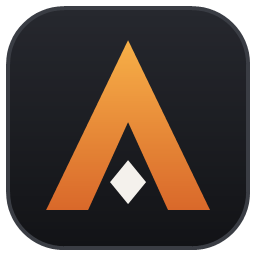

# Aion 2 Builder

[Télécharger](https://aion2-todo-7275.azurewebsites.net/api/downloads/builder/file) · [Confidentialité](#confidentialité-privacy-policy) · [Licence MIT](LICENSE) · outil non officiel, non affilié à NCSOFT

Application locale (.NET 10) qui importe ton personnage AION 2 depuis le site officiel et te dit, **pour ta classe et
en vue JcE (PvE) ou JcJ (PvP)** :

- ce qui est optimisé ou non dans ta répartition de stats (ex. « trop de Défense, pas assez de PV »),
- quelle pièce aller chercher **au palier suivant** (on ne saute pas directement au dernier stuff), pièce la plus faible d'abord,
- quoi enchanter et quoi ne plus enchanter (pièces de transition),
- quelles **gravures d'âme** et pierres revoir pièce par pièce (lien d'âme, options inutiles, pierres à changer), et dans quel ordre,
- quelle espèce de **familiers** farmer en premier (collection lue par le Pet Meter, via Aion 2 Todo),
- quelles compétences monter, équiper, ou arrêter de monter,
- **deux builds par classe, côte à côte** : celui des joueurs (guides et joueurs observés) et un build **conçu** à partir
  des seules données des sorts, chacun avec sa rotation et sa façon de jouer ; tu choisis lequel guide les conseils,
- quelles cases **Daevanion** ouvrir et dans quel ordre (chemins compris), par réserve de points (plateaux communs, Ariel en JcE, Azphel en JcJ),
- un plan d'action classé par **rentabilité** (gain attendu / ressources dépensées).

Deux interfaces partagent le même moteur :

| Projet | Rôle |
|---|---|
| `src/Aion2Builder.Core` | Import du site officiel, données de jeu, moteur de conseils |
| `src/Aion2Builder.Cli` | Ligne de commande |
| `src/Aion2Builder.App` | Interface graphique Avalonia (écrite en C#, sans XAML) |

## Lancer l'application (Windows)

1. Double-clique sur **`publier.cmd`** : il crée `publish\Aion2Builder.exe` (un seul fichier, environ 30 Mo).
2. Double-clique sur **`publish\Aion2Builder.exe`** (ou sur un raccourci vers lui sur le bureau).

Après une mise à jour du code, ferme l'application et relance `publier.cmd`. L'exe utilise le runtime .NET 10
(installé avec le SDK). Si Windows refuse de le lancer (« Une stratégie de contrôle d'application a bloqué ce
fichier »), c'est Smart App Control : voir la dernière section.

### Sur un PC sans le projet (mise à jour automatique)

À chaque push sur `main`, GitHub compile un exe autonome (pas de .NET à installer), numéroté `v1.1.<n>`, le publie
dans les [versions GitHub](https://github.com/Tomtoxi44/aion2-builder/releases) et le dépose sur Aion 2 Todo.

1. Télécharge-le une fois (dernière version GitHub, ou <https://aion2-todo-7275.azurewebsites.net/api/downloads/builder/file>)
   et range-le dans un dossier à toi (pas dans `Program Files` : l'application doit pouvoir remplacer son exe).
2. Au lancement puis toutes les 6 h, l'application regarde s'il existe une version plus récente : un bouton
   « ⬆ v1.1.n disponible » apparaît en haut à droite. Un clic la télécharge, vérifie son empreinte, remplace l'exe et
   relance l'application (l'ancienne version est effacée au lancement suivant). « Aide → Vérifier les mises à jour »
   le fait à la demande. La version en cours est affichée en bas à droite.

Une compilation locale (`publier.cmd`) porte la version « build locale » et ne propose pas de mise à jour. Les exe
publiés ne sont pas signés : Windows peut afficher « éditeur inconnu » au premier lancement (clic droit → Propriétés →
« Débloquer », ou « Exécuter quand même »), et Smart App Control les bloque. Les mises à jour faites depuis l'application
n'affichent pas cet avertissement.

## Utilisation en ligne de commande

```bash
dotnet run --project src/Aion2Builder.Cli -- advise Lyra --server Azphel --region eu --mode both
```

Commandes du CLI :

| Commande | Effet |
|---|---|
| `servers [texte] [--region eu] [--refresh]` | Liste des serveurs de la région par race, filtrable (« servers az ») |
| `search <nom> [--server S] [--region eu]` | Cherche un personnage |
| `import <nom> --server S [--raw <dossier>]` | Importe et enregistre (et garde les réponses brutes si `--raw`) |
| `import-raw <dossier>` | Réimporte des réponses brutes sauvegardées (diagnostic) |
| `advise <nom ou fichier.json> [--mode pve\|pvp\|both] [--refresh] [--json]` | Analyse et conseils, avec la rotation du build suivi |
| `advise <nom> --build joueurs\|concu` | Choisit le build qui guide les conseils (gardé par personnage) |
| `advise <nom> --md <fichier.md>` | Écrit le rapport en Markdown (à garder ou partager) |
| `simulate <nom> [--daevanion next\|respec\|route] [--n 20] [--skills] [--build joueurs\|concu] [--gear]` | Et si… : notes, familles et stats avant → après |
| `progress <nom>` | Imports successifs du personnage et ce qui a changé |
| `rotation <classe\|nom> [--targets 4] [--duration 120] [--mode pvp]` | Rotations simulées : celle des joueurs contre la conçue, sort par sort |
| `list` | Personnages enregistrés |
| `data [export] [--force]` | Montre / copie les fichiers de données modifiables |
| `pets [--key <clé>] [--refresh] [--forget]` | Relie / relit la collection de familiers (Aion 2 Todo) ; « advise » la compte ensuite |

Interface graphique :

```bash
dotnet run --project src/Aion2Builder.App
```

L'interface est organisée comme un éditeur :

- **Onglets de personnages** en haut, comme les fichiers d'un éditeur : un onglet par personnage ouvert (initiale, nom,
  classe, niveau), **Ctrl+Tab** pour passer de l'un à l'autre, **Ctrl+W** ou × pour fermer, **+** pour en ouvrir un autre.
  Les onglets sont rouverts au lancement suivant. Clic droit sur un onglet : actualiser ce personnage depuis le site
  officiel, l'ajouter à « Mes personnages », fermer l'onglet ou les autres.
- **Import** (**+**, avatar du rail ou **Ctrl+K**) : tape le nom, les résultats du site officiel s'affichent au fil de la
  saisie ; Entrée importe le meilleur résultat. L'étiquette « eu · tous serveurs » choisit la région et le serveur (liste
  filtrable, noms français). « Mes personnages » liste ceux déjà importés avec leur score (calculé en arrière-plan) ;
  ils se rouvrent sans connexion.
- **Accueil** : les quatre notes et les actions les plus rentables, à cocher « fait » (gardé jusqu'au prochain import,
  qui vérifie) ; l'inspecteur montre le personnage, un « Et si… » (score global si tu remplaces les pièces en retard,
  suis la répartition des compétences ou ouvres les 20 prochaines cases Daevanion, avec le même calcul que les notes ;
  aussi par pièce dans l'écran Équipement), sa progression d'un import à l'autre (niveau d'objet, puissance) et sa
  position parmi des joueurs niveau 45 de sa classe (« devant 30 % d'entre eux »).
- **Rail à gauche** : Accueil, Stats, Équipement, Compétences, Build, Daevanion, Familiers, Et si, Progression, Détails, chacun avec sa note.
- **Et si** : simulation sur une copie du personnage ; tu choisis les changements (prochaines cases Daevanion, réorganisation
  ou route conçue, répartition des compétences conseillée, build joueurs ou conçu, pièces en retard au niveau du palier) et
  l'analyse est refaite : notes avant → après, familles de stats et stats qui changent (calculées à partir des effets réels
  des cases), et ce que ça demande en jeu. Une pièce « au niveau du palier » ne change que la note (ses stats sont inconnues).
- **Progression** : courbes du niveau d'objet, de la puissance et du score, et pour chaque import ce qui a changé (pièces,
  niveaux de compétences, cases Daevanion ouvertes).
- **Build et rotation** : le build des joueurs et le build conçu côte à côte (priorités, niveaux visés, ≠ là où ils
  diffèrent, rotation par phases et conseils de jeu) ; « Joueurs | Conçue » choisit celui que suivent les conseils.
- **Bascule JcE | JcJ** toujours visible en haut ; **thème** : 8 couleurs secondaires au choix.
- **Inspecteur à droite** : clique une pièce, une stat, une compétence ou un plateau pour son détail. Sa largeur se règle
  en glissant sa bordure, **Ctrl+I** le masque. Les compteurs « − N + » (points non dépensés) recalculent tout de suite.
- **Menus** : Fichier → Exporter le rapport en Markdown (**Ctrl+E**) / Paramètres (**Ctrl+,** : mises à jour,
  actualisation à l'ouverture si l'import date de plus de 2, 6 ou 24 h, inspecteur, données) ; Personnage → Actualiser
  depuis le site officiel (**Ctrl+R**, F5) ; Données → Recharger les données / Ouvrir le dossier des données.
- **Raccourcis** (F1) : Ctrl+1 à Ctrl+8 pour les écrans du rail, Ctrl+M pour JcE / JcJ.

La liste des serveurs est gardée en cache une semaine dans `%APPDATA%\Aion2Builder\servers`, les personnages dans
`%APPDATA%\Aion2Builder\characters`.

## Comment l'algorithme raisonne

1. **Budget de stats.** Les stats sont ramenées à une unité commune calée sur les cases Daevanion communes du jeu
   (ATQ +3 = DÉF +30 = PV +100 = PM +50 = CRIT +5). Un « % d'ATQ » s'applique à ton ATQ plate. La répartition porte
   sur ce que tu peux changer (stats secondaires, Daevanion, titres équipés, stats divines) : les stats fixes d'une
   pièce (la DÉF d'une armure) viennent avec elle et restent hors répartition. Les stats « JcJ » ne comptent qu'en
   vue JcJ, et inversement.
2. **Profil de classe.** Chaque classe hérite d'un rôle (DPS, tank, soigneur, soutien) avec, par mode, un poids par stat et
   une répartition visée Attaque / Défense / Survie / Utilité. On compare ta répartition à la cible, on repère les stats
   qui prennent de la place sans servir la classe, et celles qui manquent.
3. **Paliers d'équipement.** Ton palier dépend de ton niveau et de ton niveau d'objet. À chaque palier correspond une
   rareté visée : en dessous, la pièce est de transition (à remplacer, enchantement plafonné à +3) ; au-dessus, elle est à
   garder (à enchanter jusqu'au niveau sûr). Les pièces en retard sur la médiane passent en premier, l'arme pèse plus lourd.
   Certains emplacements ont leur propre règle (`slotRules`) : la **ceinture noble** ne se remplace pas (pas de ceinture de
   donjon sur les serveurs occidentaux), on la monte à +10 puis on la transmute au grade supérieur.
4. **Compétences.** 1 point = +1 niveau jusqu'au niveau 10, réinitialisation gratuite ; au-delà, seuls le Daevanion, les
   arcanes et l'équipement donnent des niveaux (spécialisations à 8, 12, 16, 20). L'application recalcule les points investis
   (niveau − bonus Daevanion − bonus d'équipement), y ajoute tes points non dépensés, puis redistribue ce budget selon le
   **rôle** de chaque compétence pour ta classe et le mode (dégâts principaux, burst, débuff, contrôle, défensif…) : elle dit
   quelles compétences monter, lesquelles **réduire**, et pourquoi. Les stigmas (4 emplacements, fragments) sont classés de
   la même façon, avec le coût en fragments pour atteindre le niveau visé.
   Tout point non dépensé trouve une place, et les points posés au-dessus du niveau visé d'une compétence peu utile vont aux
   compétences utiles pas encore au maximum : une fois les conseils suivis, la répartition ne bouge plus (« ✓ points bien
   placés »). À importance égale, le sort qui fait le plus de dégâts passe d'abord. Chaque décision est écrite en clair
   (« Monte à 10 : indispensable en JcE, 24 % des dégâts simulés (n° 1). Points pris à … : ils rapportent moins là-bas. »).
   L'écran Compétences montre :
   - **Focus dégâts** : la part de chaque sort dans la rotation simulée du build suivi (2 min, une cible), son niveau total
     et d'où il vient (points, cases Daevanion, arcanes, équipement), le prochain moyen de le monter (points jusqu'à 10,
     puis cases Daevanion encore fermées, puis arcanes et équipement) et la prochaine spécialisation ;
   - ce qu'il faut faire maintenant (qui donne des points à qui), avec la raison de chaque ajout et de chaque retrait ;
   - l'ordre des prochains points jusqu'au bout, numérotés point par point (« 6–9 ») pour suivre la liste jusqu'à épuisement
     (le site ne montre pas les points non dépensés) ;
   - les **niveaux bonus de l'équipement et des arcanes** : utiles ou perdus (compétence hors barre ou peu utile), et les
     sorts à chercher sur les prochaines arcanes et pièces ;
   - toutes les compétences groupées (à monter, à baisser, inchangées) avec importance, part des dégâts et niveau visé
     (↑ à monter, ↓ au-dessus du visé, = atteint), puis les stigmas et les prochains fragments par paliers de 5.
5. **Daevanion.** Une case coûte 1, 2, 3 ou 4 points selon sa couleur (vérifié : 134 points pour Nezekan, Zikel et Vaizel,
   168 pour Triniel, 232 pour Azphel) et ne s'ouvre qu'à côté d'une case ouverte. Deux plans par réserve de points :
   - **réorganisation** : en partant de ton placement actuel, les cases peu utiles en bout de chemin (importance < 0,4)
     sont retirées si leurs points rapportent plus ailleurs → cases rouges à retirer, cases vertes à prendre ;
   - **prochaines cases** : où mettre tes prochains points sans rien retirer, avec le cumul des points ; la liste couvre
     au moins tous les points non dépensés que tu indiques (marqués « faisable »).
   - **route conçue** (bascule « Ton plateau | Route conçue ») : sans tenir compte de ton placement, le meilleur chemin
     depuis le centre pour tous tes points (dépensés + non dépensés), affiné comme une réorganisation, numéroté dans
     l'ordre d'ouverture (utile après une réinitialisation), avec sa valeur comparée à ton placement, les cases à ouvrir,
     celles hors route, et la suite pour tes prochains points.
   Sous le plateau, l'écran Daevanion liste ces cases dans l'ordre (mêmes numéros que la grille), avec la raison de chacune.
   Les niveaux de compétence valent selon l'importance de la compétence et sa part des dégâts simulés (un sort à 30 % des
   dégâts : × 1,6, `skillDamageWeight`), les stats selon leur poids et l'équilibre des familles (une famille déjà
   au-dessus de sa cible vaut moins).
6. **Gravures d'âme et pierres.** Chaque option de pièce et chaque pierre est jugée selon l'importance de sa stat pour
   ta classe et le mode : ✓ utile (≥ 0,5), ~ moyenne, ✕ à remplacer (< 0,25) ; une stat principale (Force…) vaut un peu
   moins que la stat qu'elle augmente (ATQ). Le **lien d'âme** (0 à 100 %) fait monter les options vers leur maximum et
   les verrouille à 100 %. D'où l'ordre économe : sur les pièces que tu gardes, d'abord **synchroniser** la ligne ✕
   (une seule mauvaise ligne) ou **réinitialiser** (au moins deux mauvaises lignes et lien d'âme sous 50 %, il repart de
   0), ensuite seulement monter le lien d'âme ; rien sur les pièces à remplacer. Les options et pierres à viser sont
   celles possibles sur ce type de pièce (`progression.json` → `engraving`, complété par celles vues sur tes pièces),
   classées par importance et relevées si leur famille de stats est en manque. Les pierres comptent dans ta répartition
   de stats. Écran Équipement : code **G** sur une pièce à revoir, tableau des gravures sous la silhouette.
7. **Familiers.** Chaque familier obtenu donne des stats selon son espèce et son niveau 1 à 3 (« effets de possession »,
   `progression.json` → `pets`, valeurs communautaires) : Cogni = PV, CRIT ; Fera = Précision ; Natura = RÉS aux CRIT ;
   Varian = Esquive (+ une stat principale au niveau 3, déjà dans les totaux du site officiel, donc pas recomptée). La
   collection vient du [Pet Meter](https://github.com/Tomtoxi44/aion2-pet-meter), qui l'envoie à Aion 2 Todo :
   l'application la relit avec la même clé de synchro (écran **Familiers**, ou `pets --key`). Les stats sont ajoutées à
   ta répartition ; l'espèce conseillée est celle dont un familier au niveau 3 sert le plus ta classe (relevée si sa
   famille de stats est en manque), avec les familiers les plus proches du niveau suivant.
8. **Build conçu.** Pour chaque classe, un second build est construit sans guide ni profil de joueur, à partir des
   données des sorts au niveau 1 (metabot.gg) : dégâts par seconde = % d'ATQ ÷ temps de recharge (× nombre de cibles),
   pondérés par leurs conditions (cible renversée, ralentie, déséquilibrée, sous dégâts sur la durée…), buffs et
   affaiblissements comptés par leur temps actif (durée ÷ recharge). Il ne remplace que les compétences où le calcul
   diverge des joueurs (`classes.json` → `designed` : priorités, niveaux visés, raison chiffrée), avec sa propre
   rotation et la liste des différences. C'est un calcul, pas de l'expérience en jeu : à tester.
   L'écran Build simule aussi les deux rotations (2 min, 1 cible ou un pack de 4) : les sorts à recharge partent dans
   l'ordre de la rotation dès qu'ils sont prêts et que leur condition est remplie, le meilleur sort sans recharge entre
   deux, les sorts déclenchés suivent leur déclencheur ; dégâts en % d'ATQ par seconde et part de chaque sort
   (CLI : `rotation <classe>`). Sans buffs, PM ni critiques : ça compare des ordres de priorité.

Le site officiel ne montre pas les points non dépensés (compétences, Daevanion, cristaux Ariel/Azphel) : indique-les
dans les onglets Compétences et Daevanion, ou avec `--sp`, `--dp`, `--ariel`, `--azphel` dans le CLI. Ils sont gardés par
personnage. Survole une stat, une famille de stats, une note ou une case Daevanion pour son explication.

## Ajuster les données

Poids, cibles, paliers, sources d'équipement, coûts Daevanion et libellés de stats sont dans des fichiers JSON
embarqués (`src/Aion2Builder.Core/GameData/Defaults`). Pour les modifier sans recompiler :

```bash
dotnet run --project src/Aion2Builder.Cli -- data export
```

puis édite les fichiers copiés dans `%APPDATA%\Aion2Builder\data` (un fichier présent remplace la version intégrée) et
clique « Recharger les données » dans l'application.

Les paliers d'équipement sont calés sur des personnages réels des serveurs EU (octobre 2026 : bleu, puis jaune, puis
jaune enchanté +8/+10 ; aucun orange ni rouge observé). Les autres valeurs sont **indicatives** (guides communautaires,
observations) et à affiner selon la saison. Les **8 classes** ont une fiche de compétences
détaillée (12 actives, 10 passifs, 13 stigmas). Elles croisent des guides et les compétences réellement montées par
24 joueurs niveau 45 des serveurs EU par classe (`classes.json` → `skills` : rôle, priorité et niveau visé par mode, et
la raison affichée ; les entrées « à valider » ne sont pas documentées par les guides). Les mêmes joueurs servent de
repère (`benchmark` : niveau d'objet, puissance, cases Daevanion ouvertes) pour situer un personnage dans sa classe. Le Rôdeur n'a pas de guide JcJ : ses priorités JcJ sont déduites des effets
des sorts. Deux compétences de l'Aède s'appellent « Coup fracassant » (attaque de base et stigma) : le type les départage.
Les rotations des joueurs (`classes.json` → `play`) viennent des mêmes guides ; celles du build conçu, du calcul.

## Limites

- Les adresses du site officiel ne sont pas documentées et peuvent changer sans préavis. En cas de souci,
  `import --raw <dossier>` garde les réponses pour diagnostic.
- Le site n'expose pas les stats de base de la classe : l'analyse porte sur ce qui est visible et contrôlable.
- Familiers : seuls les effets de possession sont comptés. Les stats tirées par l'analyse de perception d'espèce ne sont
  lisibles ni sur le site officiel ni par le Pet Meter. Le site Aion 2 Todo (offre gratuite) peut mettre une minute à répondre.
- Les options possibles par type de pièce sont relevées sur des pièces réelles : la liste peut être incomplète.

## Confidentialité (privacy policy)

Aion 2 Builder n'envoie rien sans que tu le demandes, sauf la vérification des mises à jour, que tu peux couper.

- **Site officiel AION 2** (`aion2.plaync.com`, `api-search.plaync.com`) : seulement quand tu cherches, importes ou
  actualises un personnage (nom cherché, région, serveur).
- **Aion 2 Todo** (`aion2-todo-7275.azurewebsites.net`) :
  - vérification des mises à jour au lancement puis toutes les 6 h : une simple demande du numéro de la dernière
    version. C'est le seul envoi automatique ; il se coupe dans **Aide → Vérifier automatiquement**. Le téléchargement
    n'a lieu que si tu cliques sur le bouton de mise à jour ;
  - familiers : seulement si tu relies ta clé de synchro, envoyée à Aion 2 Todo pour lire ta collection.
- Les requêtes portent le numéro de version de l'application (en-tête `User-Agent`). Aucune télémétrie, aucune
  statistique d'usage, rien n'est envoyé ailleurs.
- Ce que l'application garde (personnages importés, préférences, clé des familiers) reste sur ton PC, dans
  `%APPDATA%\Aion2Builder` ; supprimer ce dossier efface tout.

## Licence

[MIT](LICENSE). Outil non officiel, non affilié à NCSOFT : AION 2, ses noms et ses données appartiennent à NCSOFT.

## Compiler sous Windows avec Smart App Control

Smart App Control bloque les DLL non signées, dont les tâches de compilation d'Avalonia (compilateur XAML,
télémétrie). D'où une interface écrite en C# sans `.axaml` et la cible vide `AvaloniaStats` dans
`Directory.Build.targets`. Smart App Control bloque aussi l'exécution des binaires compilés localement : quand il est actif, l'application ne
peut pas être lancée sur ce poste (désactive-le dans Sécurité Windows → Contrôle des applications et du navigateur, ou
utilise une autre machine).
